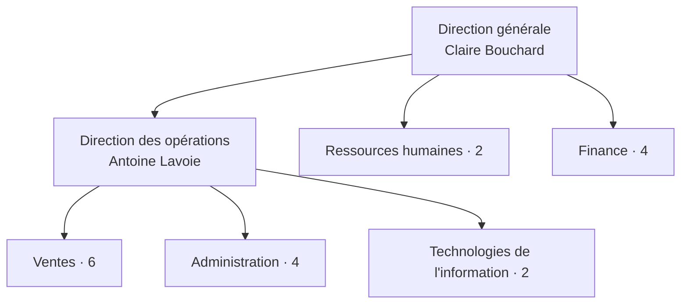

# NovaBureau : description de l'entreprise

> **Environnement entièrement fictif.** Les noms, les courriels (domaine `novabureau.example`) et les incidents sont inventés. Ce projet n'est ni un audit officiel ni une certification.

## Profil

| Élément | Détail |
|---|---|
| Raison sociale | NovaBureau inc. (fictive) |
| Secteur | Services administratifs et consultation |
| Siège | Montréal (Québec) |
| Effectif | 20 employés, dont 11 en télétravail hybride |
| Fondation | 2019 |
| Équipe TI | 2 personnes : un responsable TI et une agente de soutien et de conformité |

## Mission du service TI

Garantir que chaque employé dispose, au bon moment, des outils et des accès **strictement nécessaires** à son travail, tout en protégeant les données de l'entreprise et de ses clients et en conservant des **preuves** de chaque action.

## Organigramme

## Répartition des employés

| Département | Effectif | Données sensibles traitées | Particularités TI |
|---|---|---|---|
| Direction | 2 | Stratégie, contrats | Accès en lecture à Finance et RH |
| Ressources humaines | 2 | Dossiers des employés, paie | Dossier RH isolé |
| Finance | 4 | Factures, comptes clients | Dossier Finance isolé |
| Ventes | 6 | Données clients (CRM) | 5 télétravailleurs, VPN très utilisé |
| Administration | 4 | Courrier, réception | Gestion de l'imprimante réseau |
| TI | 2 | Journaux, configurations | Comptes administrateurs séparés |

La liste nominative fictive est disponible dans [`donnees/employes.csv`](../donnees/employes.csv).

## Rôles et responsabilités TI

| Rôle | Titulaire fictif | Responsabilités |
|---|---|---|
| Responsable TI | Thomas Caron | Infrastructure, pare-feu, fournisseurs, approbation des accès privilégiés |
| Agente soutien et conformité TI | Barbara Saroukou | Billets de soutien, arrivées et départs, revue des accès, preuves de conformité, sensibilisation |
| Gestionnaires de département | Chefs de service | Approuver les accès de leur équipe et valider les revues trimestrielles |
| Ressources humaines | Nadia Benali | Déclencher les arrivées, les départs et les changements de poste |

## Enjeux qui justifient le projet

1. **Croissance** : 4 arrivées et 2 départs prévus d'ici un an. Sans procédure, les oublis d'accès s'accumulent.
2. **Télétravail** : plus de la moitié des employés se connectent à distance (VPN, MFA).
3. **Données clients** : Finance et Ventes manipulent des renseignements personnels protégés par la *Loi 25* au Québec.
4. **Exigence des clients** : deux clients demandent désormais des preuves de bonnes pratiques de sécurité (MFA, sauvegardes, revue des accès).
