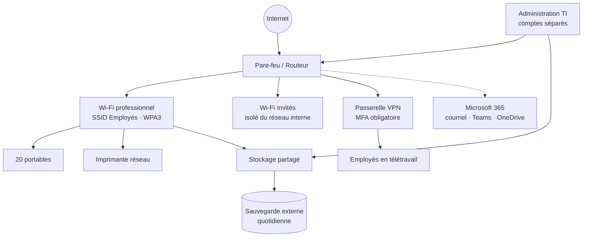

# Environnement TI de NovaBureau

## Schéma réseau



Version texte, pour les lecteurs sans rendu Mermaid :

```
                         Internet
                             |
                    Pare-feu / Routeur ---------- Microsoft 365 (infonuagique)
                             |
          ------------------------------------------
          |                  |                     |
   Wi-Fi Employés      Wi-Fi Invités          VPN distant (MFA)
          |               (isolé)                  |
 Portables + imprimante                   Employés en télétravail
          |
   Stockage partagé ---- Sauvegarde externe quotidienne
          |
   Administration TI (comptes admin séparés)
```

## Principes d'architecture

| Principe | Application chez NovaBureau |
|---|---|
| Comptes individuels | Aucun compte partagé; chaque action est attribuable à une personne. |
| Moindre privilège | Les droits sont attribués par **groupe de département**, jamais un par un. |
| Séparation des privilèges | Les membres de l'équipe TI ont un compte standard (`prenom.nom`) et un compte d'administration (`adm-prenom.nom`) utilisé seulement pour les tâches d'administration. |
| MFA partout | Obligatoire pour Microsoft 365, le VPN et les consoles d'administration. |
| Segmentation | Le Wi-Fi Invités n'a aucun accès au réseau interne. |
| Traçabilité | Les journaux de connexion sont conservés 90 jours; chaque changement passe par un billet. |

## Inventaire

L'inventaire détaillé est dans [`inventaire-actifs.csv`](inventaire-actifs.csv).

| Catégorie | Quantité | Gestion |
|---|---|---|
| Ordinateurs portables Windows 11 Pro | 20 | Chiffrement BitLocker, antivirus Microsoft Defender, mises à jour centralisées |
| Licences Microsoft 365 Business Premium | 20 | Attribuées à l'arrivée, retirées au départ |
| Pare-feu / routeur | 1 | Micrologiciel révisé chaque mois |
| Bornes Wi-Fi | 2 | 2 SSID (Employés, Invités) |
| Imprimante réseau multifonction | 1 | Pilote déployé par guide (dossier 07) |
| Stockage partagé (NAS) | 1 | Dossiers par département, sauvegarde quotidienne |
| Passerelle VPN | 1 | Client VPN sur les postes des télétravailleurs |

## Politique de mots de passe et d'authentification

- Phrase de passe d'au moins 14 caractères; aucune expiration forcée, sauf en cas de soupçon de compromission (conforme aux recommandations NIST SP 800-63B).
- Verrouillage du compte après 10 tentatives échouées, déverrouillage automatique après 15 minutes.
- MFA par application d'authentification; le SMS n'est accepté qu'en solution temporaire.
- Le soutien TI **ne demande jamais** un mot de passe à un utilisateur.
