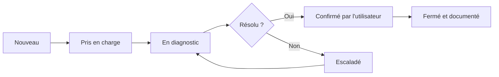

# Catalogue de services et matrice de priorité

## Comment ouvrir une demande

Portail de billets (fictif) ou courriel à `soutien@novabureau.example`. En cas d'urgence P1, téléphone au poste 2020. Chaque demande reçoit un numéro (`REQ-xxx` pour une demande de service, `INC-xxx` pour un incident) et est consignée dans le [registre](../donnees/registre-billets.csv).

## Catalogue de services

| Service | Description | Pour qui | Approbation requise | Délai cible |
|---|---|---|---|---|
| Réinitialisation de mot de passe | Récupération de l'accès après vérification d'identité | Tous | Non (vérification d'identité obligatoire) | 30 minutes |
| Déverrouillage de compte | Déblocage après vérification des journaux | Tous | Non | 30 minutes |
| Installation d'un logiciel | Logiciel figurant sur la liste approuvée | Tous | Gestionnaire si le logiciel est payant | 1 jour ouvrable |
| Accès à un dossier partagé | Ajout ou retrait dans un groupe de sécurité | Selon le besoin | **Gestionnaire du dossier** | 1 jour ouvrable |
| Assistance VPN | Résolution d'un problème de connexion à distance | Télétravailleurs | Non | 4 heures |
| Remplacement de matériel | Ordinateur ou accessoire défectueux | Tous | Gestionnaire au-delà de 150 $ | 2 jours ouvrables |
| Signalement d'un courriel suspect | Analyse d'un message potentiellement malveillant | Tous | Non | 1 heure |
| Arrivée d'un employé | Compte, licence, poste et accès | RH | **RH** | 3 jours avant l'arrivée |
| Départ d'un employé | Retrait des accès, récupération du matériel | RH | **RH** | Le jour même, à l'heure prévue |

## Matrice de priorité

La priorité combine **l'impact** (combien de personnes sont touchées) et **l'urgence** (à quelle vitesse il faut agir).

| Impact ↓ / Urgence → | Élevée (travail bloqué) | Moyenne (contournement possible) | Faible (gêne mineure) |
|---|---|---|---|
| **Toute l'entreprise** | P1 | P2 | P3 |
| **Un département** | P2 | P3 | P3 |
| **Une personne** | P3 | P3 | P4 |

| Priorité | Exemple | Délai de prise en charge | Communication |
|---|---|---|---|
| P1 — Critique | Toute l'entreprise ne peut plus travailler (stockage, Internet) | 15 minutes | Message à tous dès la prise en charge, puis toutes les 30 minutes; rapport après incident obligatoire |
| P2 — Élevée | Le service Finance n'a plus accès à ses fichiers; courriel d'hameçonnage reçu par plusieurs personnes | 1 heure | Gestionnaire du département informé |
| P3 — Moyenne | Un utilisateur ne peut pas imprimer ou se connecter au VPN | 4 heures | Utilisateur informé dans le billet |
| P4 — Faible | Installation d'un logiciel approuvé | 1 jour ouvrable | Utilisateur informé dans le billet |

**Règle d'escalade** : un billet qui dépasse 75 % de son délai cible sans solution est escaladé au responsable TI. Un soupçon de compromission (connexion inhabituelle, clic sur un lien d'hameçonnage) est automatiquement **reclassé P2** au minimum.

## Cycle de vie d'un billet

Un billet n'est fermé qu'après **confirmation de l'utilisateur** ou 2 jours ouvrables sans réponse après la solution proposée.
